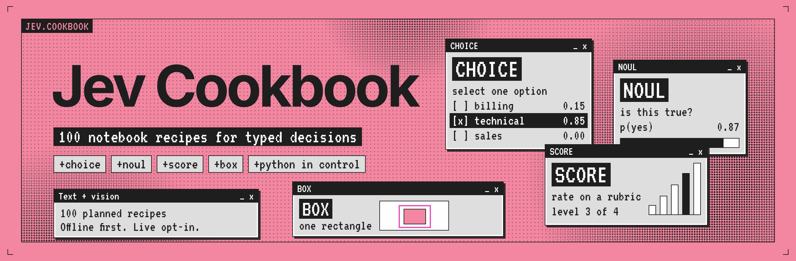
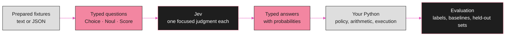

<p align="center">
  
</p>

<div align="center">

# Jev Cookbook

**100 notebook recipes for typed decisions with Jev, covering text and images, starting from a first `Choice` question.**

<!-- catalog:progress:start -->
   
<!-- catalog:progress:end -->
 [](LICENSE)

[Quick start](#quick-start) · [How a recipe works](#how-a-recipe-works) · [Decision types](#decision-types) · [Levels](#difficulty-levels) · [Categories](#browse-by-category) · [Recipes](#the-recipes) · [Sources](#sources) · [Contributing](#contributing)

</div>

---

Jev is TypeSafe AI's System One model. It does not write text. You send it a **state** and a set of **typed questions**, and it returns structured answers your code can branch on, sort by, and route with. This cookbook is a curriculum of Jupyter notebooks that teach that way of building, one bounded decision at a time.

> [!NOTE]
> **The generated badge and recipes table show what has shipped.** The catalog lists the planned use cases, categories, and difficulty levels, and it can be revised as recipes are built. A recipe counts as published once its `notebook.ipynb` is in the repository, and its row then links to the notebook. Every other row is marked coming soon. It links to the issue tracking the recipe when the catalog records one; a row for an entry with no issue yet is marked coming soon with no link. Each published recipe states in its notebook and README which mode it ran in (synthetic fixtures or recorded responses), and for recorded responses the model version the API returned and the date. Metrics from synthetic runs check that the pipeline behaves as designed. They are not Jev results. Any number reported as a Jev result states the number of examples it was measured on and the model version, comes from recorded inference on a held-out set, and makes no general claim about Jev's quality, latency, or cost. Where a recipe has no such run, its README says "not measured live".

## Quick start

You need Python 3.10 or newer and git. No API key is needed to run anything offline.

```bash
git clone https://github.com/Jev-Engineering/cookbook.git
cd cookbook
python -m venv .venv
. .venv/bin/activate   # Git Bash: source .venv/Scripts/activate; PowerShell: .venv\Scripts\Activate.ps1
pip install -e ".[dev]"
python tools/execute_notebook.py recipes/_template   # run the template notebook offline
```

The template in `recipes/_template/` is a small, complete recipe, and every recipe works the same
way; recipe 01 is the start of the curriculum once its row below links to a notebook. Three pages
take it from here:

- [Getting started](docs/getting-started.md): install, open a notebook, run it offline, run a recipe's tests, switch to live.
- [Offline and live](docs/offline-and-live.md): what each mode is, what provenance says, why synthetic metrics are pipeline checks, and what "not measured live" means.
- [Glossary](docs/glossary.md): state, question, `Choice`, `Noul`, `Score`, criteria, probabilities, confidence, threshold, replay key, fixture, provenance, and run mode, each linked to its source.

## How a recipe works

Each notebook keeps the same division of labour. Jev supplies a narrow semantic judgment. Python does everything exact: arithmetic, retrieval, policy, permissions, and execution.



A question is a few lines of Python. This is the shape recipe 01 starts from, using the TypeSafe Python SDK:

```python
from typesafe_sdk import Choice, TypeSafeClient

with TypeSafeClient() as client:  # reads TYPESAFE_API_KEY
    response = client.system_one(
        state={"review": "Arrived fast, but the lid cracked within a week."},
        questions={
            "sentiment": Choice(
                instructions="What is the overall sentiment of this review?",
                criteria={"positive": None, "neutral": None, "negative": None, "mixed": None},
            ),
        },
    )

print(response.choices["sentiment"].choice)
```

What every recipe assumes:

| | |
| --- | --- |
| **You** | Know basic Python. No machine learning background is needed for levels 1 to 3. |
| **Data** | Prepared text or JSON fixtures that ship with the recipe. The inputs are written for the recipe, never real data. Stored answers are synthetic unless the recipe says they were recorded from real calls, with the model and the date. |
| **Actions** | Simulated. No recipe sends a message, moves a file, or touches a real system. |
| **Model calls** | Offline by default, replaying fixtures. Live Jev calls are opt-in with your own key. |
| **Claims** | Runs on synthetic or scripted answers show that the pipeline works. Statements about quality, latency, or cost need recorded inference on a held-out set, with the model version, the capture date and the number of examples (N), and a recipe says which one you are looking at. |

## Decision types

The catalog uses Jev's own vocabulary. Every recipe is tagged with the primitives it asks for.

| Type | Role | How to read it |
| --- | --- | --- |
| `Choice` | Select one option | Select one item from supplied alternatives, including none, other, or uncertain outcomes when the task needs them. Returns the choice, a probability per option, and a confidence. |
| `Noul` | Judge a proposition | Return the probability that a stated proposition holds. Tasks that allow several labels ask one independent question per label. There is no separate confidence field. |
| `Score` | Evaluate a rubric | Return a position and a distribution over ordered rubric levels you define. Exact measurements and arithmetic stay in code. |
| `Box` | Locate one target | Return one bounding rectangle for one target, with four edges as fractions of the image's width and height and a confidence. It is never a mask and never a set of detections, and it always returns a rectangle, even when the target is absent, so check presence separately, for example with a paired `Noul`. Requires the Jev 1.14 preview and the experimental images header. |
| Combination | Compose judgments | Combine independent questions in Python, and make a later request when one judgment depends on an earlier answer. |

A single label can stand for several independent questions of that type. Thresholds are a property of the task, so each recipe that uses one chooses it from examples and evaluates it.

## Difficulty levels

In the original track (ranks 1 to 60) the levels rise with rank: rank 1 is the easiest recipe and rank 60 the most demanding, so follow those ranks for a full learning sequence. The multimodal track (ranks 61 to 100) is ordered by category block, not by difficulty, so its levels rise and fall as the rank increases; use each recipe's level, or pick a category, to choose a path through it.

<!-- catalog:levels:start -->
| Level | Name | What a notebook at this level involves | Recipes |
| :---: | --- | --- | :---: |
| **1** | [Beginner](#level-1--beginner) | One bounded judgment over a short prepared input with direct inspection of typed results. | 11<br><sub>01 to 10, 61</sub> |
| **2** | [Easy](#level-2--easy) | Context-sensitive matching, scoring, or verification with candidate sets and explicit uncertain or no-match outcomes. | 24<br><sub>11 to 23, 66, 69 to 76, 85 to 86</sub> |
| **3** | [Intermediate](#level-3--intermediate) | Multiple judgments or stages, structured evidence, deterministic composition, and task-level evaluation. | 34<br><sub>24 to 39, 62 to 65, 67 to 68, 77 to 79, 81 to 82, 87 to 93</sub> |
| **4** | [Advanced](#level-4--advanced) | Stateful workflows, provenance, adversarial cases, model calibration, or several integrated decision stages. | 22<br><sub>40 to 52, 80, 83 to 84, 94 to 97, 99 to 100</sub> |
| **5** | [Expert](#level-5--expert) | Controlled optimization studies or closed-loop simulations requiring budgets, baselines, and held-out or trajectory evaluation. | 9<br><sub>53 to 60, 98</sub> |
<!-- catalog:levels:end -->

Ranks are editorial estimates of implementation and evaluation effort. Neighbouring recipes are ordered for learning, not by a measured difference in difficulty.

## Browse by category

<!-- catalog:categories:start -->
| Category | Recipes | Levels | Recipe numbers |
| --- | :---: | :---: | --- |
| **Data quality & knowledge graphs** | 9 | 2 to 5 | `14` `22` `33` `34` `37` `39` `40` `47` `57` |
| **Agent orchestration** | 8 | 2 to 4 | `11` `27` `28` `29` `43` `44` `49` `51` |
| **Bounding boxes & spatial reasoning** | 8 | 3 to 4 | `77` `78` `79` `80` `81` `82` `83` `84` |
| **Image understanding & visual judgments** | 8 | 1 to 3 | `61` `62` `63` `64` `65` `66` `67` `68` |
| **Language & content** | 8 | 1 to 2, 4 | `01` `03` `05` `06` `07` `12` `13` `48` |
| **Multiframe & temporal understanding** | 8 | 2 to 3 | `85` `86` `87` `88` `89` `90` `91` `92` |
| **Multimodal & long context** | 8 | 3 to 5 | `93` `94` `95` `96` `97` `98` `99` `100` |
| **Visual criteria & reference matching** | 8 | 2 | `69` `70` `71` `72` `73` `74` `75` `76` |
| **Evaluation & optimization** | 7 | 2 to 5 | `23` `35` `38` `50` `53` `54` `55` |
| **Search & retrieval** | 6 | 1 to 4 | `08` `10` `17` `20` `30` `52` |
| **Trust & security** | 6 | 2 to 5 | `15` `16` `26` `41` `42` `56` |
| **Workflow & service operations** | 6 | 1 to 3 | `02` `04` `09` `18` `24` `25` |
| **Games & simulation** | 5 | 2 to 3, 5 | `21` `36` `58` `59` `60` |
| **Software engineering** | 3 | 2 to 3 | `19` `31` `32` |
| **Memory & context** | 2 | 4 | `45` `46` |
<!-- catalog:categories:end -->

## The recipes

<!-- catalog:recipes:start -->
### Original track (01–60)

Text and structured-state decisions using Choice, Noul, and Score, from single judgments to evaluated workflows and simulations.

#### Level 1 · Beginner

One bounded judgment over a short prepared input with direct inspection of typed results.

| # | Recipe | Category | Decision | Status |
| :---: | --- | --- | --- | --- |
| 01 | **Sentiment classification**<br>Classify a short customer review as positive, neutral, negative, or mixed using a fixed set of labels. | Language & content | `Choice` | [Open notebook](recipes/01-sentiment-classification/notebook.ipynb) |
| 02 | **Refund intent detection**<br>Judge whether a customer message explicitly requests a refund so Python can flag it for the appropriate workflow. | Workflow & service operations | `Noul` | [Open notebook](recipes/02-refund-intent-detection/notebook.ipynb) |
| 03 | **Response clarity scoring**<br>Score a support response against a clearly defined clarity rubric to identify examples that need editing. | Language & content | `Score` | [Open notebook](recipes/03-response-clarity-scoring/notebook.ipynb) |
| 04 | **Support ticket routing**<br>Assign a support ticket to a fixed service category or an unclear-request outcome using its subject and description. | Workflow & service operations | `Choice` | [Open notebook](recipes/04-support-ticket-routing/notebook.ipynb) |
| 05 | **Document classification**<br>Classify a short document as an invoice, meeting note, policy, technical guide, or other document type from its text. | Language & content | `Choice` | [Open notebook](recipes/05-document-classification/notebook.ipynb) |
| 06 | **Multiple topic labels**<br>Tag customer feedback with every applicable topic by asking an independent yes-or-no question for each predefined label. | Language & content | `Noul` | [Open notebook](recipes/06-multiple-topic-labels/notebook.ipynb) |
| 07 | **Word sense selection**<br>Select the intended meaning of an ambiguous word from a fixed sense inventory using its surrounding sentence. | Language & content | `Choice` | [Open notebook](recipes/07-word-sense-selection/notebook.ipynb) |
| 08 | **FAQ selection**<br>Select the best matching FAQ from a short candidate list, including a no-match outcome when none addresses the question. | Search & retrieval | `Choice` | [Open notebook](recipes/08-faq-selection/notebook.ipynb) |
| 09 | **File organization**<br>Recommend a destination folder from a fixed catalog using a file's name and text excerpt so Python can preview the proposed organization. | Workflow & service operations | `Choice` | [Open notebook](recipes/09-file-organization/notebook.ipynb) |
| 10 | **Answer relevance check**<br>Judge whether a candidate response addresses the user's question so a notebook can separate relevant answers from off-topic replies. | Search & retrieval | `Noul` | [Open notebook](recipes/10-answer-relevance-check/notebook.ipynb) |

#### Level 2 · Easy

Context-sensitive matching, scoring, or verification with candidate sets and explicit uncertain or no-match outcomes.

| # | Recipe | Category | Decision | Status |
| :---: | --- | --- | --- | --- |
| 11 | **Clarification selection**<br>Select a useful follow-up question from a predefined catalog when a task description omits information needed for the next step. | Agent orchestration | `Choice` | [Open notebook](recipes/11-clarification-selection/notebook.ipynb) |
| 12 | **Thesaurus word selection**<br>Choose a context-appropriate synonym from a supplied thesaurus list while retaining the original word when no alternative preserves its meaning. | Language & content | `Choice` | [Open notebook](recipes/12-thesaurus-word-selection/notebook.ipynb) |
| 13 | **Candidate rewrite selection**<br>Choose a supplied sentence rewrite that preserves the original meaning and requested tone, with a no-suitable-rewrite outcome when necessary. | Language & content | `Choice` | [Open notebook](recipes/13-candidate-rewrite-selection/notebook.ipynb) |
| 14 | **Source span selection**<br>Select the supplier name from text spans already extracted by Python, with a not-stated outcome when the document lacks that field. | Data quality & knowledge graphs | `Choice` | [Open notebook](recipes/14-source-span-selection/notebook.ipynb) |
| 15 | **Sensitive text triage**<br>Flag synthetic documents that may contain personal information so a simulated review queue can prioritize redaction checks. | Trust & security | `Noul` | [Open notebook](recipes/15-sensitive-text-triage/notebook.ipynb) |
| 16 | **Discord moderation triage**<br>Classify sample Discord messages as allowed, review-needed, or potentially violating a supplied community rule to populate a simulated moderator queue. | Trust & security | `Choice` | [Open notebook](recipes/16-discord-moderation-triage/notebook.ipynb) |
| 17 | **Passage reranking**<br>Score retrieved passages against a question so Python can rank candidate evidence and retain each passage's source reference. | Search & retrieval | `Score` | [Open notebook](recipes/17-passage-reranking/notebook.ipynb) |
| 18 | **Duplicate incident matching**<br>Select a matching incident from a retrieved ticket shortlist, or no match, using descriptions of the symptoms and affected service. | Workflow & service operations | `Choice` | [Open notebook](recipes/18-duplicate-incident-matching/notebook.ipynb) |
| 19 | **CI failure classification**<br>Classify recorded continuous-integration failures as test regressions, dependency problems, infrastructure failures, or unknown to select the next diagnostic workflow. | Software engineering | `Choice` | [Open notebook](recipes/19-ci-failure-classification/notebook.ipynb) |
| 20 | **Claim support classification**<br>Classify whether a provided passage supports, contradicts, or leaves unresolved a specific claim while preserving the passage identifier. | Search & retrieval | `Choice` | [Open notebook](recipes/20-claim-support-classification/notebook.ipynb) |
| 21 | **Quiz answer adjudication**<br>Judge whether a typed quiz response matches an accepted answer by meaning, with partial-match and review outcomes for ambiguous responses. | Games & simulation | `Choice` | [Open notebook](recipes/21-quiz-answer-adjudication/notebook.ipynb) |
| 22 | **CMDB asset matching**<br>Link differently worded software asset descriptions to a canonical configuration-management record from a bounded candidate list or a no-match outcome. | Data quality & knowledge graphs | `Choice` | [Open notebook](recipes/22-cmdb-asset-matching/notebook.ipynb) |
| 23 | **Pairwise answer evaluation**<br>Compare two candidate answers against one explicit rubric criterion while retaining tie and insufficient-evidence outcomes for evaluation against human labels. | Evaluation & optimization | `Choice` | [Open notebook](recipes/23-pairwise-answer-evaluation/notebook.ipynb) |

#### Level 3 · Intermediate

Multiple judgments or stages, structured evidence, deterministic composition, and task-level evaluation.

| # | Recipe | Category | Decision | Status |
| :---: | --- | --- | --- | --- |
| 24 | **Incident priority composition**<br>Score reported business impact and urgency against separate rubrics so Python can map the scores to defined categories and apply a fixed service-priority matrix. | Workflow & service operations | `Score` | [Open notebook](recipes/24-incident-priority-composition/notebook.ipynb) |
| 25 | **Change evidence review**<br>Check whether a proposed change includes sufficient implementation, validation, and rollback evidence so a deterministic checklist can identify review gaps. | Workflow & service operations | `Noul` | [Open notebook](recipes/25-change-evidence-review/notebook.ipynb) |
| 26 | **Prompt-injection screening**<br>Flag instruction-redirection attempts in retrieved text using adversarial and benign quotation fixtures to measure false positives and missed attacks. | Trust & security | `Noul` | [Open notebook](recipes/26-prompt-injection-screening/notebook.ipynb) |
| 27 | **Function selection**<br>Select a function from a preapproved catalog for a request while Python validates supplied arguments before simulated execution. | Agent orchestration | `Choice` | [Open notebook](recipes/27-function-selection/notebook.ipynb) |
| 28 | **Skill selection**<br>Score retrieved skill descriptions for relevance to a task so Python can select a suitable skill or request clarification. | Agent orchestration | `Score` | [Open notebook](recipes/28-skill-selection/notebook.ipynb) |
| 29 | **Tool outcome verification**<br>Classify recorded tool outcomes as complete, partial, failed, or unverifiable using the original request and observed evidence. | Agent orchestration | `Choice` | [Open notebook](recipes/29-tool-outcome-verification/notebook.ipynb) |
| 30 | **Citation verification**<br>Check each answer claim against its cited passage and flag unsupported or contradicted claims while Python verifies citation identifiers. | Search & retrieval | `Choice` | [Open notebook](recipes/30-citation-verification/notebook.ipynb) |
| 31 | **Patch risk triage**<br>Assess a small patch for separate authentication, input-validation, and data-loss concerns to prioritize human review using explicit rules. | Software engineering | `Noul` | [Open notebook](recipes/31-patch-risk-triage/notebook.ipynb) |
| 32 | **Regression test selection**<br>Score candidate tests against the behavior changed by a patch so Python can propose a focused regression suite. | Software engineering | `Score` | [Open notebook](recipes/32-regression-test-selection/notebook.ipynb) |
| 33 | **Schema field mapping**<br>Map source field descriptions to a bounded target schema with ambiguous and unmapped outcomes before Python validates the proposed mappings. | Data quality & knowledge graphs | `Choice` | [Open notebook](recipes/33-schema-field-mapping/notebook.ipynb) |
| 34 | **Evidence relationship labels**<br>Label candidate entity pairs with an allowed relationship type or no-supported-relation using provided evidence passages. | Data quality & knowledge graphs | `Choice` | [Open notebook](recipes/34-evidence-relationship-labels/notebook.ipynb) |
| 35 | **Semantic feature extraction**<br>Convert text into predefined semantic features with independent judgments and compare a classifier trained on those features with a fixed baseline. | Evaluation & optimization | `Noul` | [Open notebook](recipes/35-semantic-feature-extraction/notebook.ipynb) |
| 36 | **Card-game action selection**<br>Select a legal action in a turn-based card-game simulator using structured state and fixed action descriptions while Python enforces game rules. | Games & simulation | `Choice` | [Open notebook](recipes/36-card-game-action-selection/notebook.ipynb) |
| 37 | **Research domain tagging**<br>Assign independently judged research-domain labels to evidence passages while Python preserves provenance and enforces access controls. | Data quality & knowledge graphs | `Noul` | [Open notebook](recipes/37-research-domain-tagging/notebook.ipynb) |
| 38 | **Abstention and review queues**<br>Route uncertain ticket classifications to review using thresholds selected from validation examples and measure accuracy versus coverage on a held-out set. | Evaluation & optimization | `Choice` | [Open notebook](recipes/38-abstention-and-review-queues/notebook.ipynb) |
| 39 | **Document extraction cascade**<br>Select candidate values for document fields, verify each selection against its source span, and route uncertain or inconsistent records to review. | Data quality & knowledge graphs | `Choice` + `Noul` | [Open notebook](recipes/39-document-extraction-cascade/notebook.ipynb) |

#### Level 4 · Advanced

Stateful workflows, provenance, adversarial cases, model calibration, or several integrated decision stages.

| # | Recipe | Category | Decision | Status |
| :---: | --- | --- | --- | --- |
| 40 | **Hierarchical classification**<br>Route documents through a taxonomy in stages while Python carries competing branches forward when early judgments are uncertain. | Data quality & knowledge graphs | `Choice` | [Open notebook](recipes/40-hierarchical-classification/notebook.ipynb) |
| 41 | **Approval scope review**<br>Flag semantic mismatches between an approved task and a proposed tool action while Python enforces exact permissions and approval bindings. | Trust & security | `Noul` | [Open notebook](recipes/41-approval-scope-review/notebook.ipynb) |
| 42 | **Outbound disclosure screening**<br>Screen proposed outbound messages for disclosure concerns against supplied sharing rules while deterministic controls hold flagged or uncertain samples for review. | Trust & security | `Noul` | [Open notebook](recipes/42-outbound-disclosure-screening/notebook.ipynb) |
| 43 | **Failure recovery selection**<br>Select retry, alternative method, or escalation from a bounded recovery catalog using execution history while Python enforces retry budgets and stop conditions. | Agent orchestration | `Choice` | [Open notebook](recipes/43-failure-recovery-selection/notebook.ipynb) |
| 44 | **Plan constraint assessment**<br>Evaluate each candidate plan against individual user constraints so deterministic policy can reject ineligible plans and route unresolved judgments to review. | Agent orchestration | `Noul` | [Open notebook](recipes/44-plan-constraint-assessment/notebook.ipynb) |
| 45 | **Memory reconciliation**<br>Classify a new memory statement as corroborating, superseding, contradicting, or unrelated to existing evidence so a versioned store can preserve provenance and unresolved conflicts. | Memory & context | `Choice` | [Open notebook](recipes/45-memory-reconciliation/notebook.ipynb) |
| 46 | **Semantic context paging**<br>Judge stored context chunks for relevance to the current task so Python can retain, page out, or rehydrate them while preserving original content and source links. | Memory & context | `Score` | [Open notebook](recipes/46-semantic-context-paging/notebook.ipynb) |
| 47 | **Evidence conflict diagnosis**<br>Classify apparent claim conflicts by factual disagreement, time, entity, or scope using source excerpts and temporal relationships already computed by Python. | Data quality & knowledge graphs | `Choice` | [Open notebook](recipes/47-evidence-conflict-diagnosis/notebook.ipynb) |
| 48 | **Document revision consistency**<br>Select among externally supplied sentence revisions and check their consistency with paragraph context as Python assembles a versioned document. | Language & content | `Choice` + `Noul` | [Open notebook](recipes/48-document-revision-consistency/notebook.ipynb) |
| 49 | **Multi-agent task assignment**<br>Score each agent's suitability for a subtask so a deterministic scheduler can assign work under capability, dependency, and budget constraints. | Agent orchestration | `Score` | [Open notebook](recipes/49-multi-agent-task-assignment/notebook.ipynb) |
| 50 | **Model comparison and calibration**<br>Compare Jev and alternative decision backends on identical labeled tasks, calibrating each model separately and measuring held-out quality, latency, and cost. | Evaluation & optimization | `Choice` + `Noul` + `Score` | [Open notebook](recipes/50-model-comparison-and-calibration/notebook.ipynb) |
| 51 | **Stalled-loop detection**<br>Classify progress across recorded agent turns as advancing, repeating, regressing, or complete so Python can apply a continue, change-strategy, or stop policy. | Agent orchestration | `Choice` | Coming soon · [#51](https://github.com/Jev-Engineering/cookbook/issues/51) |
| 52 | **Retrieval pipeline evaluation**<br>Combine passage filtering, reranking, and claim verification in a retrieval pipeline and measure each stage's effect on answer support using a fixed labeled corpus. | Search & retrieval | `Choice` + `Score` | Coming soon · [#52](https://github.com/Jev-Engineering/cookbook/issues/52) |

#### Level 5 · Expert

Controlled optimization studies or closed-loop simulations requiring budgets, baselines, and held-out or trajectory evaluation.

| # | Recipe | Category | Decision | Status |
| :---: | --- | --- | --- | --- |
| 53 | **Semantic feature discovery**<br>Judge text against externally proposed semantic features, select a feature set through a budgeted validation search, and evaluate the frozen downstream classifier on an untouched test set. | Evaluation & optimization | `Noul` + `Score` | Coming soon · [#53](https://github.com/Jev-Engineering/cookbook/issues/53) |
| 54 | **Question and policy optimization**<br>Optimize Jev question wording, criteria, and decision thresholds with an external search loop, then compare frozen variants on an untouched test set. | Evaluation & optimization | `Choice` + `Noul` + `Score` | Coming soon · [#54](https://github.com/Jev-Engineering/cookbook/issues/54) |
| 55 | **Adaptive model routing**<br>Use Jev judgments to drive a model-routing policy and compare quality, latency, and cost across traffic mixes while Python enforces budgets and fallback rules. | Evaluation & optimization | `Choice` + `Score` | Coming soon · [#55](https://github.com/Jev-Engineering/cookbook/issues/55) |
| 56 | **Adversarial harness evaluation**<br>Evaluate Jev screening at input, retrieved-context, proposed-action, and output boundaries using adversarial replay while measuring attack success, false positives, and task completion. | Trust & security | `Noul` | Coming soon · [#56](https://github.com/Jev-Engineering/cookbook/issues/56) |
| 57 | **Evidence graph updates**<br>Combine entity, relationship, and evidence judgments into a proposed graph update that Python validates and applies transactionally in a simulated store with replayable provenance. | Data quality & knowledge graphs | `Choice` + `Noul` | Coming soon · [#57](https://github.com/Jev-Engineering/cookbook/issues/57) |
| 58 | **Simulated process supervision**<br>Select supervisory responses to simulated PLC fault descriptions and telemetry while Python enforces interlocks and a separate controller handles timing and actuation. | Games & simulation | `Choice` + `Noul` | Coming soon · [#58](https://github.com/Jev-Engineering/cookbook/issues/58) |
| 59 | **Observation and action selection**<br>Choose the next permitted observation and subsequent legal action in a partially observed game, then compare complete trajectories with a rule-based baseline. | Games & simulation | `Choice` | Coming soon · [#59](https://github.com/Jev-Engineering/cookbook/issues/59) |
| 60 | **Factory production control**<br>Select bounded production goals and recovery actions from structured factory state while a Factorio-style simulator executes predefined action templates and measures throughput, stalls, and resource use. | Games & simulation | `Choice` + `Noul` + `Score` | Coming soon · [#60](https://github.com/Jev-Engineering/cookbook/issues/60) |

### Multimodal track (61–100)

Experimental image judgments, visual reference matching, Box localization, ordered still-frame analysis, and multimodal long-context evaluation.

#### Multimodal level 1 · Beginner

One bounded judgment over a short prepared input with direct inspection of typed results.

| # | Recipe | Category | Decision | Status |
| :---: | --- | --- | --- | --- |
| 61 | **Screenshot error-state recognition**<br>Classify an application screenshot as a crash, loading state, authentication failure, normal operation, or unknown using fixed visual categories. | Image understanding & visual judgments | `Choice` | Coming soon |

#### Multimodal level 2 · Easy

Context-sensitive matching, scoring, or verification with candidate sets and explicit uncertain or no-match outcomes.

| # | Recipe | Category | Decision | Status |
| :---: | --- | --- | --- | --- |
| 66 | **Technical schematic recognition**<br>Identify a predefined circuit, wiring, or infrastructure symbol from a cropped schematic image, retaining an unknown outcome for ambiguous or unlisted symbols. | Image understanding & visual judgments | `Choice` | Coming soon |
| 69 | **Visual SKU recognition**<br>Select a product variant from a fixed SKU catalog whose choice criteria contain reference photographs, with no-match and uncertain outcomes. | Visual criteria & reference matching | `Choice` | Coming soon |
| 70 | **Brand identity verification**<br>Compare a displayed logo or marketing asset with an approved reference image using bounded visual conformity checks and route uncertain results to review. | Visual criteria & reference matching | `Noul` | Coming soon |
| 71 | **Golden-sample assembly checks**<br>Score an assembly photograph against rubric levels illustrated by good and defective reference examples so Python can identify candidates for inspection. | Visual criteria & reference matching | `Score` | Coming soon |
| 72 | **Board-game piece recognition**<br>Identify a token, tile, figurine, or card from fixed categories defined by reference images, including an unknown outcome for unseen or ambiguous pieces. | Visual criteria & reference matching | `Choice` | Coming soon |
| 73 | **Visual UI state identification**<br>Classify a cropped UI component as selected, disabled, active, hovered, error, or unknown using visual examples in each choice criterion. | Visual criteria & reference matching | `Choice` | Coming soon |
| 74 | **Material swatch matching**<br>Match a textile, paint, flooring, or material photograph to a controlled collection of visual swatches, with no-match and uncertain outcomes for appearance ambiguity. | Visual criteria & reference matching | `Choice` | Coming soon |
| 75 | **Generated-art style consistency**<br>Score a generated illustration against separate art-direction criteria illustrated by a supplied moodboard, using explicit rubric levels and retaining each criterion score. | Visual criteria & reference matching | `Score` | Coming soon |
| 76 | **Plant appearance matching**<br>Compare a plant photograph with labeled visual examples to suggest a candidate appearance group, including unknown for unsupported or ambiguous matches. | Visual criteria & reference matching | `Choice` | Coming soon |
| 85 | **Door state transition detection**<br>Classify a door as opened, closed, unchanged, or uncertain across chronologically ordered PNG or JPEG frames sampled by Python. | Multiframe & temporal understanding | `Choice` | Coming soon |
| 86 | **Object arrival/departure detection**<br>Determine whether a specified package, vehicle, or other object appeared, disappeared, remained, or is uncertain across ordered still frames of a scene. | Multiframe & temporal understanding | `Choice` | Coming soon |

#### Multimodal level 3 · Intermediate

Multiple judgments or stages, structured evidence, deterministic composition, and task-level evaluation.

| # | Recipe | Category | Decision | Status |
| :---: | --- | --- | --- | --- |
| 62 | **Visual regression detection**<br>Compare before-and-after screenshots for missing elements, misalignment, clipping, and other predefined visual changes, then score each change against an explicit severity rubric. | Image understanding & visual judgments | `Noul` + `Score` | Coming soon |
| 63 | **Manufacturing defect inspection**<br>Check synthetic product photographs for scratches, dents, missing components, and incorrect assembly with independent judgments and a defined defect-severity rubric. | Image understanding & visual judgments | `Noul` + `Score` | Coming soon |
| 64 | **Field maintenance photo triage**<br>Classify predefined equipment conditions in maintenance photographs and independently flag visible corrosion, leaks, or disconnected cabling for a simulated review queue. | Image understanding & visual judgments | `Choice` + `Noul` | Coming soon |
| 65 | **Retail shelf compliance**<br>Compare shelf photographs with an approved planogram image using independent checks for misplaced or missing product groups while Python combines the findings. | Image understanding & visual judgments | `Noul` | Coming soon |
| 67 | **Product finish verification**<br>Compare a product photograph with a visual reference using separate color, material, and finish checks and explicit similarity rubrics under controlled imaging conditions. | Image understanding & visual judgments | `Noul` + `Score` | Coming soon |
| 68 | **Visual accessibility screening**<br>Flag apparent text clipping, low contrast, crowding, and overlapping UI components with independent screenshot judgments to identify candidates for further accessibility testing. | Image understanding & visual judgments | `Noul` | Coming soon |
| 77 | **Visual browser element locator**<br>Locate a named button, form input, or menu item in a screenshot and check target presence before Python draws the rectangle and previews a simulated browser action. | Bounding boxes & spatial reasoning | `Box` + `Noul` | Coming soon |
| 78 | **Signature and stamp localization**<br>Check whether a synthetic scanned document contains a requested signature or approval stamp and locate one matching region for Python to crop and evaluate. | Bounding boxes & spatial reasoning | `Box` + `Noul` | Coming soon |
| 79 | **Engineering diagram component locator**<br>Check for and locate a specified valve, connector, or symbol on an engineering diagram while Python converts normalized box edges into a visible annotation. | Bounding boxes & spatial reasoning | `Box` + `Noul` | Coming soon |
| 81 | **Defect localization**<br>Check for one specified visible scratch, dent, or broken component, then draw and evaluate its bounding rectangle while suppressing boxes for absent targets. | Bounding boxes & spatial reasoning | `Box` + `Noul` | Coming soon |
| 82 | **Reference-guided object search**<br>Locate a particular product on a cluttered shelf or workbench using its reference photo in the instructions, with an independent presence check before accepting the rectangle. | Bounding boxes & spatial reasoning | `Box` + `Noul` | Coming soon |
| 87 | **Game phase transition detection**<br>Recognize transitions between combat, menus, map selection, and rewards from ordered game screenshots while Python records the phase history and handles uncertain transitions. | Multiframe & temporal understanding | `Choice` | Coming soon |
| 88 | **Visual action verification**<br>Compare screenshots before and after a simulated browser action to judge whether the intended UI change is visible while Python preserves the action and frame records. | Multiframe & temporal understanding | `Noul` | Coming soon |
| 89 | **Conveyor jam detection**<br>Evaluate ordered synthetic factory frames for visible blockage or halted conveyor movement and score the evidence using a fixed rubric while Python controls sampling and timing. | Multiframe & temporal understanding | `Noul` + `Score` | Coming soon |
| 90 | **Assembly progression recognition**<br>Identify the predefined assembly stage reached in a chronological photograph sequence, retaining unknown or inconsistent outcomes for review. | Multiframe & temporal understanding | `Choice` | Coming soon |
| 91 | **Sports action phase recognition**<br>Classify a short ordered still-image sequence as preparation, execution, recovery, or an unrecognized movement using supplied phase definitions. | Multiframe & temporal understanding | `Choice` | Coming soon |
| 92 | **Video highlight candidate detection**<br>Score frame sequences for separately defined highlight signals such as visible reactions or unusual scene changes while Python samples video and maps candidate windows to timestamps. | Multiframe & temporal understanding | `Score` | Coming soon |
| 93 | **Image-grounded bug report verification**<br>Check whether a screenshot supports each claimed bug symptom using the description, error logs, and expected behavior, preserving evidence links for a simulated review queue. | Multimodal & long context | `Noul` | Coming soon |

#### Multimodal level 4 · Advanced

Stateful workflows, provenance, adversarial cases, model calibration, or several integrated decision stages.

| # | Recipe | Category | Decision | Status |
| :---: | --- | --- | --- | --- |
| 80 | **Game HUD perception**<br>Identify and locate a requested energy meter, card, action button, or enemy indicator in a synthetic screenshot of an invented, unbranded deck-building game HUD, with absent and ambiguous outcomes before any simulated action. | Bounding boxes & spatial reasoning | `Box` + `Choice` | Coming soon |
| 83 | **Hierarchical visual search**<br>Select among Python-generated image tiles, retaining no-match and uncertain outcomes, then progressively localize a small target while Python maps the final rectangle back to the full image. | Bounding boxes & spatial reasoning | `Choice` + `Box` | Coming soon |
| 84 | **Bounding-box self-verification**<br>Check target presence, localize it, and ask independent questions about whether it continues past each crop edge so Python can adjust the rectangle within fixed retry and size limits. | Bounding boxes & spatial reasoning | `Box` + `Noul` | Coming soon |
| 94 | **Long-form visual evidence audit**<br>Compare inspection photographs with individual statements in an extended report or maintenance history using opt-in long context while Python preserves evidence provenance and review outcomes. | Multimodal & long context | `Noul` | Coming soon |
| 95 | **AI livestream overlay verification**<br>Compare gameplay frames and recorded agent state with displayed strategy, phase, and action overlays to flag unsupported status claims in a simulated livestream review. | Multimodal & long context | `Noul` | Coming soon |
| 96 | **Multilingual visual instruction verification**<br>Classify whether photographs and signage support instructions across languages, comparing pinned Jev 1.13 and 1.14 versions on identical labeled tasks with an uncertain outcome. | Multimodal & long context | `Choice` | Coming soon |
| 97 | **Photo-based equipment troubleshooting**<br>Combine a photographed symptom, equipment model information, and a long troubleshooting manual to select candidate diagnostic checks from a supplied catalog for simulated review. | Multimodal & long context | `Choice` | Coming soon |
| 99 | **Historical screenshot sequence analysis**<br>Check candidate state transitions against a long sequence of screenshots and textual test logs so Python can identify the earliest supported visible transition associated with a defect. | Multimodal & long context | `Noul` | Coming soon |
| 100 | **Multimodal agent handoff verification**<br>Classify a reported agent result and independently check its claims against screenshots and tool records before deterministic policy permits a simulated handoff or requests review. | Multimodal & long context | `Choice` + `Noul` | Coming soon |

#### Multimodal level 5 · Expert

Controlled optimization studies or closed-loop simulations requiring budgets, baselines, and held-out or trajectory evaluation.

| # | Recipe | Category | Decision | Status |
| :---: | --- | --- | --- | --- |
| 98 | **Long-context versus focused-context evaluation**<br>Compare judgments using contexts up to the opt-in 262k-token limit with retrieval and staged decisions across all four decision types on identical labeled tasks, with frozen policies, held-out evaluation, and measured resource use. | Multimodal & long context | `Choice` + `Noul` + `Score` + `Box` | Coming soon |
<!-- catalog:recipes:end -->

## Repository layout

The layout the recipes are being built into. `catalog/recipes.json` is the source of truth for this README, and a recipe flips from coming soon to a notebook link when its `notebook.ipynb` lands.

```text
cookbook/
├── catalog/recipes.json      the 100 planned recipes, machine readable
├── recipes/NN-slug/          one folder per recipe: notebook.ipynb, README.md, fixtures/
├── src/jev_cookbook/         shared helpers: backends, fixtures, evaluation, plotting
├── tools/render_catalog.py   regenerates the tables in this README
├── orchestration/PROMPT.md   the multi-agent build plan for this repository
└── CONTRIBUTING.md           the recipe contract every notebook has to meet
```

## Sources

The use cases are proposed applications. Their ranks are curriculum judgments, not ratings published by the sources. The references below were reviewed on 6 October 2026 (S01 to S08) and 15 October 2026 (S09 to S12). Each reference's review date is recorded in `catalog/recipes.json`, and the references that apply to a recipe are listed in that recipe's catalog entry. S07 describes limitations of the documented Jev 1.13 model specifically.

<!-- catalog:sources:start -->
| ID | Reference | What it supports |
| :---: | --- | --- |
| S01 | [TypeSafe AI: Introduction](https://docs.typesafe.ai/introduction) | Typed questions over supplied state and atomic judgments composed in code. |
| S02 | [TypeSafe AI: Primitives (Questions)](https://docs.typesafe.ai/primitives) | Choice, Noul, Score, independent questions, and dependent follow-up calls. |
| S03 | [TypeSafe AI: Confidence](https://docs.typesafe.ai/confidence) | Distribution-derived confidence and task-specific thresholds informed by observed outcomes. |
| S04 | [TypeSafe AI: How to build with TypeSafe](https://docs.typesafe.ai/concepts/how-to-build-with-system-one) | Narrow semantic judgments integrated with workflows, deterministic logic, and side effects controlled by code. |
| S05 | [TypeSafe AI: Example use cases](https://docs.typesafe.ai/concepts/use-case-map) | Application families covering classification, routing, scoring, retrieval, and verification. |
| S06 | [TypeSafe AI: Cookbooks](https://docs.typesafe.ai/cookbooks) | Worked patterns for extraction, citation checking, skill selection, hierarchical classification, and feature discovery. |
| S07 | [TypeSafe AI: Jev 1.13 jaggedness](https://docs.typesafe.ai/model-jaggedness/jev-1.13) | Version-specific limitations affecting arithmetic, context selection, adversarial content, and generation. |
| S08 | [TypeSafe AI: System One Adapter](https://github.com/typesafe-ai/system-one-adapter-python) | A typed interface for comparing Jev with decision adapters backed by generative models. |
| S09 | [TypeSafe AI: Images](https://docs.typesafe.ai/images) | Experimental PNG/JPEG assets in state, instructions, and criteria; image comparisons and ordered still frames with the images header. |
| S10 | [TypeSafe AI: Box](https://docs.typesafe.ai/primitives/box) | Jev 1.14 single-target bounding rectangles, normalized edges and confidence, absent-target checks, tiled search, and crop verification. |
| S11 | [TypeSafe AI: Models and long context](https://docs.typesafe.ai/models) | Versioned model IDs, moving aliases, and opt-in 262k-token per-request and per-question context for Jev 1.13 and 1.14. |
| S12 | [TypeSafe AI: Jev 1.14 release](https://typesafe.ai/blog/jev-1-14) | The October 14, 2026 release of Jev 1.14 and the experimental status of image, Box, and long-context capabilities. |
<!-- catalog:sources:end -->

## Contributing

Recipes are built against one contract, described in [CONTRIBUTING.md](CONTRIBUTING.md): offline by default, synthetic fixtures, Python in control of every side effect, and no quality claim without a measured run. Progress is tracked in [issues](https://github.com/Jev-Engineering/cookbook/issues) and [milestones](https://github.com/Jev-Engineering/cookbook/milestones), with each recipe's assigned issue recorded in its catalog entry (`issue` is null until one is assigned). A recipe's rank is not its issue number; see [CONTRIBUTING.md](CONTRIBUTING.md).

<p align="center">
<sub>An independent project by <a href="https://github.com/Jev-Engineering">Jev-Engineering</a> · Steward: Complete Tech LLC · MIT licensed<br>
Not an official TypeSafe AI publication. The pink, ink and pixel-window styling is a nod to <a href="https://typesafe.ai">typesafe.ai</a>; Jev, System One and TypeSafe are their respective owner's names.</sub>
</p>
