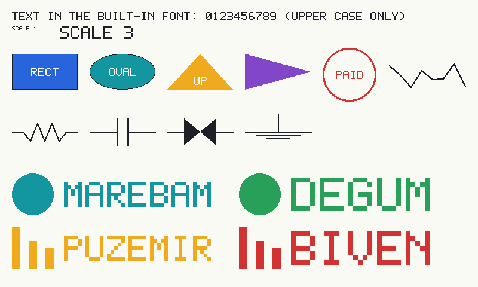
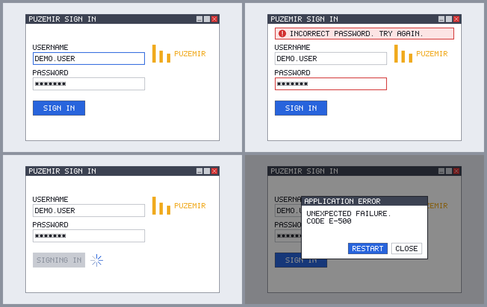
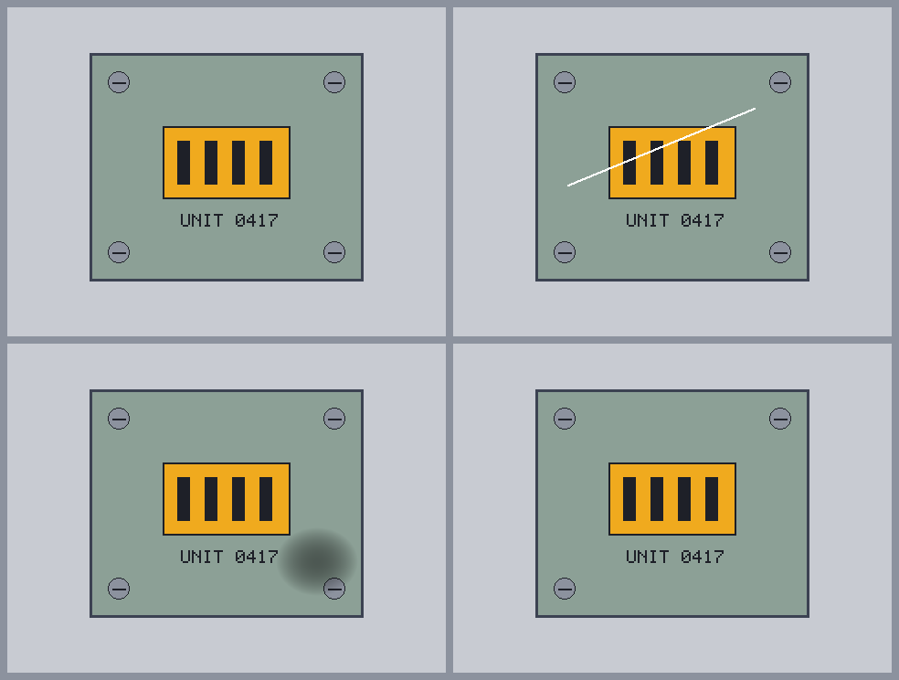
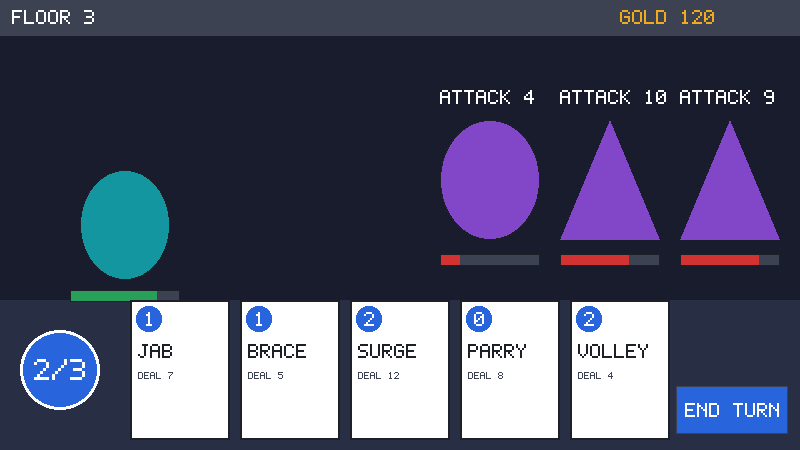
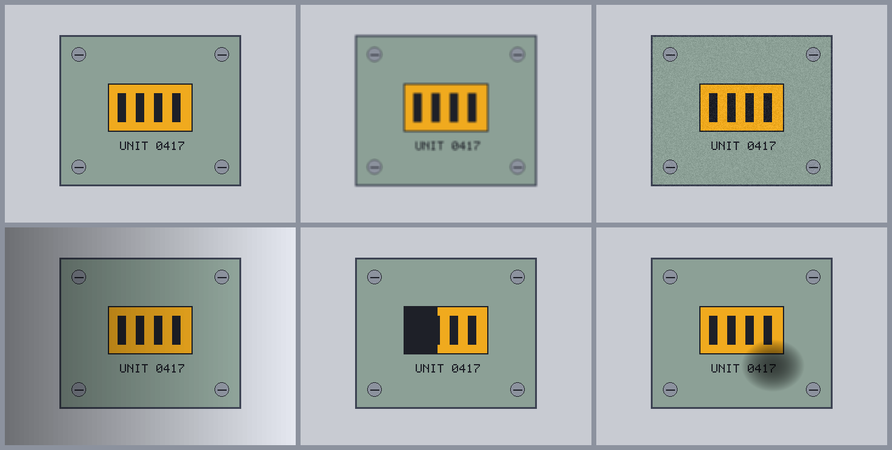
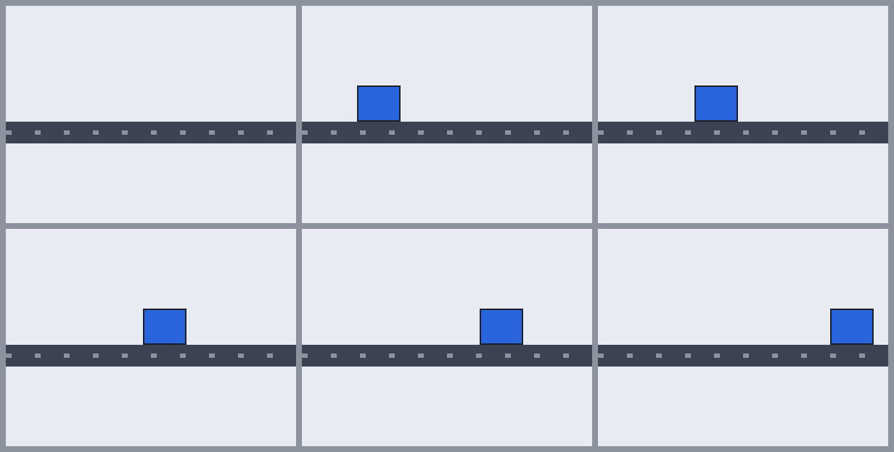

# Synthetic test images

The multimodal recipes (ranks 61 to 100) need images that a person can read and a model can be
asked about: sign-in screens, parts with a scratch, shelves, a game HUD, a belt with a box on it.
[CONTRIBUTING.md](../CONTRIBUTING.md) section 5 requires every fixture to be fabricated, so each
of those images is **drawn by code**. `jev_cookbook.synthetic_images` is the shared drawing kit:
Pillow and the standard library only, no system font, no download, and no real picture anywhere.

## The rule

> An image in this repository is drawn by the recipe's code. It contains **no real photograph, no
> real brand or logo, no real person and no third-party copyrighted image or screenshot**, and every
> name in it is invented. A deck-building game is "a deck-builder HUD", never a real game's art,
> card names, layout or title.

The provenance manifest ([fixtures.md](fixtures.md#image-provenance-manifest)) makes the author
attest this for every file, and a reviewer checks the picture against it. The kit makes the rule
cheap to keep: `fictional_name` invents names (pronounceable nonsense, not a trademark search, so a
reviewer still rejects one that happens to match a real company), `wordmark` draws an invented logo
from geometric shapes, and everything else is flat shapes and a small built-in font.

What the kit **does not** do: it does not make photographs. A "product photograph" in a recipe is a
drawing of a product. That is enough to teach the pipeline (a typed question, a box, a presence
rule, an evaluation) and is honest about what the fixture is, but it says nothing about how Jev
reads real photographs, and the recipe's evaluation must label it a pipeline check.



## A worked example

This is the `build_fixtures.py` of a small demo recipe: it draws two sign-in screens with the
shipped scene function and two shelf images with a scene of its own, saves them, and writes the
manifest. [`tests/test_synthetic_images.py`](../tests/test_synthetic_images.py) runs this exact
block in an empty folder, then validates what it wrote.

```python
"""build_fixtures.py of a demo recipe: draw the images, save them, write the manifest.

python build_fixtures.py              # create assets/, or check it against what is drawn
python build_fixtures.py --overwrite  # accept a changed picture (then rebuild replay_keys)
"""

import json
import sys
from pathlib import Path

from jev_cookbook import synthetic_images as si
from jev_cookbook.vision import gold_box, image_asset, image_reference, normalized_to_pixels

HERE = Path(__file__).resolve().parent


def draw_shelf(*, gaps: list[int], seed: int = 0) -> si.Canvas:
    """Six products on a shelf; each slot listed in ``gaps`` is empty (a product is missing)."""
    canvas = si.Canvas(480, 320, "paper", seed=seed)
    canvas.rect(20, 130, 440, 12, "dark", name="shelf")
    slots = si.grid_positions(30, 40, columns=6, rows=1, cell_width=60, cell_height=90, gap=10)
    colours = ["blue", "teal", "amber", "purple", "green", "red"]
    for index, (x, y) in enumerate(slots):
        fill = canvas.rng.choice(colours)
        canvas.labelled_object(x, y, 60, 90, fill, name=f"product_{index}", label=f"P{index + 1}")
    for index in gaps:
        canvas.missing_part(f"product_{index}", name=f"gap_{index}")
    return canvas.provenance("build_fixtures.py:draw_shelf", {"gaps": gaps, "seed": seed})


def build() -> dict[str, tuple[si.Canvas, str]]:
    """Every image: its path under the recipe, the canvas that draws it, what it shows."""
    return {
        "assets/login-normal.png": (
            si.login_screen(state="normal", seed=3),
            "A sign-in window, ready for input.",
        ),
        "assets/login-error.png": (
            si.login_screen(state="error", seed=3),
            "The same window after a rejected password: a red banner and a red field.",
        ),
        "assets/shelf-full.png": (draw_shelf(gaps=[]), "A shelf with all six products."),
        "assets/shelf-gap.png": (draw_shelf(gaps=[2]), "The same shelf, product 3 missing."),
    }


def main(overwrite: bool) -> int:
    images = build()
    entries = []
    for path, (canvas, description) in images.items():
        try:
            status = canvas.write(HERE, path, overwrite=overwrite)
        except si.RegenerationMismatch as error:
            print(f"refused: {error}")
            return 1
        print(f"{status}: {path}")
        entries.append(canvas.manifest_entry(HERE, path, description))
    manifest = {"schema": 1, "assets": entries}
    (HERE / "assets-manifest.json").write_text(json.dumps(manifest, indent=2) + "\n", "utf-8")

    # Gold labels are derived from what was drawn, never typed in.
    submit = images["assets/login-error.png"][0].objects["submit"]
    gap = images["assets/shelf-gap.png"][0].objects["gap_2"]
    labels = {
        "login-error": submit.label(),  # the button is there
        "shelf-gap": gap.label(),  # where product 3 should be
        "shelf-full": si.absent_label(),  # nothing is missing in this one
    }
    assert gold_box(labels["login-error"]) == submit.box
    assert normalized_to_pixels(submit.box, 640, 400) == (80, 262, 220, 302)
    assert gold_box(labels["shelf-full"]) is None
    print(json.dumps(labels["shelf-gap"]))

    # The reference a request will use for the picture (a hash of the committed bytes).
    print(image_reference(image_asset("assets/login-error.png", root=HERE)))
    return 0


if __name__ == "__main__":
    sys.exit(main("--overwrite" in sys.argv))
```

Run it once and the four files appear under `assets/` with an `assets-manifest.json` beside them.
Run it again and every line says `unchanged`. Change the drawing code so that a picture changes and
it prints `refused: ...` and exits 1 **without writing anything**: a changed picture is a new
hash, which changes every replay key that includes it, so it is a decision for a person
([below](#byte-stability-and-regeneration)).

## What the kit returns: gold geometry

Every primitive is a method of `Canvas` and returns a `Drawn`: the exact pixel rectangle it drew.

| `Drawn` | Meaning |
| - | - |
| `pixels` | `(left, top, right, bottom)`, right and bottom exclusive, as in a Pillow crop, clipped to the canvas. |
| `box` | The normalized `{"top", "bottom", "left", "right"}`: each pixel edge divided by the image height or width. It is what `vision.normalized_to_pixels` maps back to `pixels`, and what a gold Box label holds. |
| `label()` | `{"present": True, "box": box}`, the label for a target that is in the image. `absent_label()` is `{"present": False}`. |
| `center` | The middle pixel, where a simulated click would land. |
| `parts`, `attrs` | The pieces of a composite (a window's title bar and buttons), and facts such as `text`, `label`, `style`, `fraction`. |

The box is the **extent of what was drawn**, found from the pixels the primitive painted, not a
rectangle that was merely asked for. A shape clipped by the canvas edge reports its visible part,
a triangle whose first row holds no pixel centre reports the rows that do, and the line box of a
text is its first glyph cell to its last (ink never leaves it). Tests assert for every primitive
that the changed pixels fit inside the returned box, and for most that they fill it exactly.

Give a primitive `name=` and it is recorded in `canvas.objects[name]` (a name can be used once, so a
typo cannot silently reuse a box). Composites record their parts as `"<name>.<part>"`. A recipe
builds its labels from `canvas.objects`, never from numbers it typed.

## Primitives

All coordinates are integers: `(x, y)` is the top-left pixel and `w`, `h` a size in pixels.
Colours are `PALETTE` names (`"ink"`, `"blue"`, ...) or `(r, g, b)`.

| Group | Methods |
| - | - |
| Canvas | `Canvas(width, height, background, seed=)`: each side 280 to 1568 pixels and at most 2,458,624 pixels, the API's limits (`ValueError` otherwise). |
| Shapes | `rect`, `ellipse`, `triangle` (apex up, down, left or right), `line` (any width), `labelled_object` (a named shape with a centred label), `grid_positions` (cells of a shelf, board or tile set). |
| Text | `text`, `centered_text`, `text_block`, `text_width`, `fit_scale` (below). |
| UI mock | `window` (title bar, three control squares, content area), `button` (primary, secondary, danger, disabled), `text_input` (label, masked, placeholder, focused, invalid), `dialog` (modal, with an optional dimmed backdrop), `error_banner` (error, warning, info), `spinner` (eight spokes, a phase), `bar` (progress or health). |
| Documents and diagrams | `stamp`, `signature` (a seeded scribble, never a name), `schematic_symbol` (`resistor`, `capacitor`, `valve`, `ground`). |
| Logo | `wordmark` (an invented name beside a geometric emblem; `style_seed` picks them, and `text=`, `emblem=`, `colour=` override them to make an off-brand variant), `fictional_name`. |
| Defects | `scratch`, `dent` (radial shading), `missing_part` (paints a part out; the returned box is where it was). |
| Perturbations | `blur`, `noise`, `lighting` (brightness, with a left-to-right gradient for a shadow), `occlude` (cover a fraction of a target from one side). |
| Frames | `moving_object_frame(s)`, `build_frames`, `save_frames`, `interpolate`. |

**Text** uses a 5 by 7 bitmap font drawn for this module (MIT, like the repository), at an
integer `scale`. It has `A-Z`, `0-9`, space and ``. , : ; - _ + = / ( ) ! ? % # * ' " < > [ ]``;
lower case is folded to upper case (the folded text is what `attrs["text"]` reports) and any other
character raises `ValueError` instead of drawing a blank. There is no system font and no FreeType
involved, which is what makes the pixels the same everywhere. It has no accents and no
non-Latin scripts: a recipe that needs them (rank 96, multilingual instructions) needs a decision
about a committed font that this module does not make.

**Randomness** comes from `Rng`, splitmix64 written in integer arithmetic (`Rng(0).u64()` is
`0xE220A8397B1DCDAF`, the published first output for seed 0). Python's `random` is not used: only
`random.random()` is stable across releases. A canvas has its own stream (`seed=`), advanced only by
primitives that need randomness (`signature`, `scratch`, `dent`, `noise`, and the scenes' own
choices), so a fixed sequence of calls always draws the same pixels.

### Example scenes

Four documented scenes are pure functions of JSON arguments, so a manifest's `generator` and
`parameters` rebuild them (`reproduce`, `check_reproducible`). They are starting points to read,
copy and change, not a catalogue.

| Scene | Arguments | Objects (names in `canvas.objects`) | Serves |
| - | - | - | - |
| `login_screen` | `state` (`normal`, `error`, `loading`, `crash`), `seed` | `window`, `logo`, `username`, `password`, `submit`, and `error_banner`, `spinner` or `dialog` | 61, 62, 73, 77, 88, 93, 99, 100 |
| `part_photo` | `defect` (`none`, `scratch`, `dent`, `missing_screw`), `seed` | `part`, `screw_tl` ..., `connector`, `serial`, `defect` | 63, 67, 71, 81, 82 |
| `deck_hud` | `cards` 1-5, `enemies` 0-3, `energy`, `energy_max`, `seed` | `player`, `enemy_i` (+ `.intent`, `.hp`), `energy`, `card_i`, `end_turn` | 80, 87, 95 |
| `moving_object_frame` | `t`, `start`, `end`, `travel_seconds`, `appear_at`, `disappear_at`, `object_size`, `seed` | `belt`, and `item` while present | 85 to 92 |





The other kinds in the track are composed from primitives the same way `draw_shelf` is above:
shelves and planograms from `grid_positions` and `labelled_object`; schematics from
`schematic_symbol` and `line`; documents from `text_block`, `stamp` and `signature`; board pieces
from `labelled_object` shapes; logos from `wordmark`. The gallery images are regenerated by
[`docs/assets/synthetic-images/build_gallery.py`](assets/synthetic-images/build_gallery.py) (a test
checks that the committed files are what it draws).

## Hard and ambiguous cases

A perturbation changes the picture and never moves a gold box, so the label stays valid while the
task gets harder. Each returns a `Drawn` for the region it changed.



```python
from jev_cookbook import synthetic_images as si

screen = si.login_screen(state="normal", seed=3)
submit = screen.objects["submit"]
assert submit.pixels == (80, 262, 220, 302)

screen.blur(1)  # soft focus: a 3-pixel box blur, edges clamped
screen.noise(6)  # sensor noise, about -6 to 6 per channel, from the canvas's own stream
screen.lighting(70, gradient_percent=30)  # a shadow that lifts from left to right
cover = screen.occlude("submit", fraction=0.4, side="right", fill="paper")

assert submit.pixels == (80, 262, 220, 302)  # the target is still where it was
assert cover.pixels == (164, 262, 220, 302)  # 40 percent of 140 pixels is 56
```

`occlude` records how much was hidden (`fraction`, `side`), so a recipe can label a half-covered
button "present, partly hidden" and keep a separate rule for "too hidden to trust". An
**absent** target is not a perturbation: draw the scene without the object (a login screen in
another state, a shelf with no gap) and label it `absent_label()`. Python decides what a returned
rectangle for an absent target means; see [vision.md](vision.md#presence-confidence-and-evaluation).

## Frame sequences

`moving_object_frames(times, ...)` draws one still per time. The times are explicit and are
checked like `vision.load_frames` checks them (finite, non-negative, strictly increasing), so a
recipe never implies a frame rate. The item's position is exact integer interpolation between
`start` and `end`, clamped outside `travel_seconds`, with halves rounding up; the item is present
only from `appear_at` to `disappear_at`.

```python
import tempfile

from jev_cookbook import synthetic_images as si
from jev_cookbook.vision import load_frames

frames = si.moving_object_frames([0.0, 1.0, 2.5, 4.0], appear_at=0.5)
assert "item" not in frames[0].objects  # not yet on the belt
assert frames[1].objects["item"].pixels == (95, 110, 155, 160)  # 20 + (320 - 20) * 1 / 4 = 95
assert frames[2].objects["item"].pixels == (208, 110, 268, 160)  # 187.5 pixels, rounded up

with tempfile.TemporaryDirectory() as folder:
    pairs = si.save_frames(frames, folder, "belt")  # assets/belt-00.png, ...
    state, assets = load_frames(pairs, root=folder)
assert [row["timestamp_seconds"] for row in state] == [0.0, 1.0, 2.5, 4.0]
```

For a sequence of your own, `build_frames(times, draw)` calls `draw(t)` for each time and returns
`Frame(timestamp_seconds, canvas)` objects; give the canvas a `provenance(...)` for the manifest.
Each frame is a still: there is no video file or codec anywhere (see the
[multimodal track](multimodal-track.md)).



## Saving and the manifest

`canvas.write(recipe_dir, "assets/name.png")` (or `write_asset`) saves RGB PNG bytes with only the
`IHDR`, `IDAT` and `IEND` chunks, so no text, time, profile or resolution chunk can appear, and
checks the file with `vision.image_asset(..., root=recipe_dir)`. A file over 1 MiB is refused when
it is encoded. The image-file contract, with the 280 pixel minimum, is in
[fixtures.md](fixtures.md#the-image-file-contract) and is enforced by
`python tools/check_recipe_assets.py`; the tests run that checker over what the kit writes.

`canvas.manifest_entry(recipe_dir, path, description)` returns the entry for
[`assets-manifest.json`](fixtures.md#image-provenance-manifest): the hash, format and size read
from the file, `origin: generated`, the five attestations that are true of a drawing, and the
canvas's `generator` and `parameters`. For an example scene the generator is
`jev_cookbook.synthetic_images:<scene>` and the parameters are its arguments, which is exactly what
the manifest's `generator` field allows for shared code. For your own scene call
`canvas.provenance("build_fixtures.py:draw_shelf", {...})` as above, with a generator that exists in
the recipe and arguments that rebuild the image. `manifest_entry(...)` is also available on its own,
with the signature of the helper shown in fixtures.md (which it extends by checking that the
generator exists). The fixture validator confirms that a script generator exists in the recipe; it
does not run it, and it does not look inside `jev_cookbook.*` generators, so the recipe's own test
should (next block).

```python
import json
from pathlib import Path

from jev_cookbook import synthetic_images as si

RECIPE_DIR = Path.cwd()  # the recipe folder, where its tests run

manifest = json.loads((RECIPE_DIR / "assets-manifest.json").read_text("utf-8"))
for entry in manifest["assets"]:
    if entry["generator"].startswith("jev_cookbook.synthetic_images:"):
        # rebuild the image from the entry's parameters; compare with the committed file
        assert si.check_reproducible(RECIPE_DIR, entry) in ("unchanged", "kept-committed-bytes")
```

## Byte stability and regeneration

An image's bytes are part of the replay key (`backends.replay_key` hashes them), so a regenerated
file that differs by one byte silently invalidates every fixture that names it. Two layers keep
that from happening.

**The pixels are exactly reproducible.** Nothing here uses FreeType, anti-aliasing, floating point
or `random`: the font, ellipses, triangles, lines, blur and noise are integer arithmetic, so the
decoded pixels are a pure function of the arguments and seed, on every Python (3.10 and 3.14 are
tested), operating system and Pillow version. The tests pin the pixel hash of every example scene.

**The bytes are canonical only under the pinned Pillow.** The PNG encoder's zlib output can change
between Pillow builds (a different zlib), so:

1. **Committed asset bytes are canonical.** What is in the repository is the truth; its SHA-256 is
   in the manifest.
2. **Under the notebook constraints pin** (`CANONICAL_PILLOW`, which a test keeps equal to the
   Pillow in [`.github/constraints-notebooks.txt`](../.github/constraints-notebooks.txt)),
   regenerating must reproduce the committed bytes exactly.
3. **Under any other Pillow** the check is the decoded pixels: if they match, the committed bytes
   stay (nothing is rewritten); if they differ, it is a mismatch.
4. **A mismatch never rewrites anything.** `write_asset` and `write_png` raise
   `RegenerationMismatch` and leave the file alone. `overwrite=True` (the demo's `--overwrite`) is
   the explicit decision; after it the file has a new hash, so rebuild the manifest, the
   `replay_keys` and any recorded responses, and read the diff of the picture.

| `write_asset` result | When |
| - | - |
| `created` | The file did not exist. |
| `unchanged` | The bytes are the same. |
| `kept-committed-bytes` | Different bytes, same decoded pixels, and the Pillow is not `CANONICAL_PILLOW`. Nothing written. |
| `rewritten` | `overwrite=True` and the bytes differed. |
| raises `RegenerationMismatch` | Different pixels, or different bytes under `CANONICAL_PILLOW` (the generator changed the encoding), and no `overwrite`. |

CI installs Pillow unpinned for the test matrix, so a regenerated gallery or recipe image on a
newer Pillow is compared by pixels there; the notebook job and anyone who installs with the
constraints file compare bytes. Only PNG is generated: a JPEG's bytes depend on the libjpeg build,
so a lossy variant of a picture should be made with `blur` or `noise`, not by saving as JPEG.

## A checklist for a recipe

1. Draw with this module (or primitives of your own on a `Canvas`), with fixed seeds; no real
   photograph, brand, person or third-party image, and invented names.
2. Derive every gold Box label from a `Drawn`; label an absent target with `absent_label()`.
3. Build hard cases with `blur`, `noise`, `lighting` and `occlude`, and keep ambiguous and absent
   examples in the data.
4. Save with `canvas.write`, never `Image.save`; write the manifest with `canvas.manifest_entry`.
5. Put image paths in `fields` (`assets/name.png`) and compute `replay_keys` with
   `replay_key(state, questions, assets=assets)` in the same script.
6. Add a recipe test like the block above so a changed scene fails loudly.
7. Describe each image honestly: it is a drawing, and its scores are pipeline checks.
