# Synthetic images

Every multimodal recipe (ranks 61-100) needs images whose content is fully known: a screen with
an error banner, a shelf with one gap, a plate with a scratch, three frames of a door opening.
`jev_cookbook.synthetic_images` draws them from code. Import it in a recipe's `build_fixtures.py`,
not in the notebook: the notebook loads the committed files from `assets/`.

```python
from pathlib import Path

from jev_cookbook import synthetic_images as si

RECIPE_DIR = Path(__file__).resolve().parent  # recipes/NN-slug

image = si.ui_mock(seed=3, error="SAVE FAILED: NAME IS REQUIRED")
saved = si.write_asset(image, RECIPE_DIR / "assets" / "save-error.png")

label = {"error_present": True, "box": image.box("error_banner")}  # derived, not typed
manifest_row = saved.manifest_entry("assets/save-error.png")  # provenance, see below
```

## The rule

**No fixture contains a real photograph, a real brand, a real person, a screenshot of a real
product or a third-party copyrighted image.** Everything is drawn from code under the repository
licence, with invented names (`FICTIONAL_BRANDS`, "ORBITAL DESK", "QUILLEN WORKS") and geometric
art. The catalog's "Slay the Spire 2-style" HUD is a *deck-builder HUD* (`deck_builder_hud`): a
purple disc, a health bar and a hand of cards with invented names, never a real game's art,
names or layout. The fictional names are invented words, not checked against trademark
registers; do not replace them with a real name. Neither the hygiene check nor the fixture
validator can detect a real photograph, so this is a review rule: a recipe pull request whose
`assets/` was not produced by this module (or by code the recipe commits and documents) needs a
stated licence for every file, as [fixtures.md](fixtures.md) and the
[multimodal track](multimodal-track.md) require.

## What it gives you

| Function | Draws | Gold elements |
| - | - | - |
| `shapes_scene` | Labelled coloured circles, squares, triangles and diamonds | `<colour>_<kind>`, `label_<colour>_<kind>` |
| `ui_mock` | A window with title bar, inputs, buttons, optional error banner, spinner, modal dialog | `window`, `title_bar`, `input_<field>`, `button_<label>`, `error_banner`, `spinner`, `dialog`, `dialog_button` |
| `wordmark` | An invented logo: emblem and name | `emblem`, `wordmark`, `logo` |
| `document_page` | A form: header, wrapped text, signature scribble, stamp | `header`, `title`, `body`, `line_<i>`, `signature`, `stamp` |
| `product_shelf` | Invented boxes, bottles and cans with brand labels and price tags; empty slots | `product_<i>`, `gap_<i>`, `brand_<i>`, `price_<i>` |
| `defect_panel` | A plate with bolts and a part number; a scratch, a dent or a missing bolt | `part`, `bolt_<i>`, `defect` |
| `deck_builder_hud` | An invented battle HUD: enemy, health bar, energy orb, a hand of cards | `enemy`, `health_bar`, `energy_orb`, `card_<i>`, `end_turn_button` |
| `schematic` | A line-drawn circuit: resistor, capacitor, lamp, switch, battery | `<kind>_<n>`, `label_<kind>_<n>`, `battery_1` |
| `moving_object_frames`, `appearing_object_frames` | A frame sequence with explicit timestamps; an object that moves, arrives or leaves | per frame: `Frame.target` (`None` while absent) |

Below those sits `Canvas`: `rect`, `ellipse`, `polygon`, `line`, `polyline`, `text`,
`text_centered`, `text_block`, and the defect and perturbation helpers `scratch`, `dent`, `erase`,
`blur`, `noise`, `lighting`, `dim` and `occlude`. Use it directly for a scene no generator covers;
`canvas.finish(generator, parameters, seed, elements)` turns the result into the same
`SyntheticImage`.

**Every call returns its geometry.** A drawing call returns a `Placed`: the tight pixel bounds
of what that call changed (`(left, top, right, bottom)`, exclusive right and bottom, as in Pillow
crops) and the same rectangle normalized as `placed.box`, which `jev_cookbook.vision` accepts
directly. A generator returns a `SyntheticImage` whose `elements` map names to `Placed`;
`image.box("error_banner")` is the label. Nothing is typed by hand: the tests wrap every drawing
call and check that no changed pixel lies outside the box it returned. A later call can draw over
an earlier element; the box describes the call, not the final picture. `gap_<i>` is a layout
rectangle (nothing is painted there), which is what a "missing product" label needs.

**Hard and ambiguous cases.** Every generator takes `perturbations=[("blur", 2), ("dim", 30)]`
(kinds `blur`, `noise`, `dim`, `vignette`, `glare`, applied in order after drawing) and
`occlude="<element>"`, which covers the right half of that element with a flat block. The gold
box stays the element's full rectangle: that is the point of an occluded or blurred case.

**Frames.** `moving_object_frames([0.0, 0.75, 1.5])` and `appearing_object_frames(times,
appear_at=1.0, disappear_at=3.0)` take explicit timestamps (finite, nonnegative, strictly
increasing, like `vision.load_frames`) and return `Frame(timestamp_seconds, image, target)`, so an
"arrival" or "departure" label is derived from the timestamps. `save_sequence(sequence,
RECIPE_DIR / "assets" / "frames", "belt", root=RECIPE_DIR)` writes the files and returns
`(timestamp, relative_path, SavedImage)` rows to store in a fixture's `fields` and pass to
`vision.load_frames(..., root=RECIPE_DIR)`.

## Readable by construction

* **No fonts.** Text uses a 5 x 7 bitmap font defined in the module (written for this repository
  and released with it under the repository licence), scaled by an integer. No system font, no
  FreeType, nothing to ship or to vary between machines.
* **Minimum size.** `Canvas.text` requires `scale >= 2`: capitals at least 14 pixels tall, 12
  pixels per character. The generators use 2 for captions and 3 or more for everything else.
* **Contrast.** Text is refused unless its colour contrasts at least 3:1 with the pixels beneath
  it (`min_contrast=`).
* **Charset.** `A-Z`, `0-9`, space and `. , : ; ! ? - + / \ ( ) [ ] % # $ ' " = _ * < > @ &`
  (`SUPPORTED_CHARS`). Lower case is folded to upper case; any other character raises. Recipes
  that need other scripts (rank 96, multilingual instructions) need a committed, licensed font
  and their own renderer; that is not covered here.
* **Proof.** The tests read every string back out of the rendered pixels (`read_text`).

## Byte stability

An image's bytes are part of the replay key (`backends.replay_key` hashes them through
`image_reference`), so regenerating an asset must never change it silently.

**The bytes depend on this module only.** Pixels are integer `numpy` arrays filled by integer
geometry (no floating-point rasterisation, no Pillow `ImageDraw`, no `ImageFilter`, no FreeType);
randomness is SplitMix64 (`Rng`), whose output is fixed by its definition, not `random`, whose
`randrange` and `shuffle` have changed between Python releases; the PNG is written by
`encode_png`, which emits `IHDR`, one `IDAT` and `IEND` with a fixed-Huffman deflate stream it
computes itself, because zlib and Pillow's PNG writer differ between versions (Pillow's wheels
changed zlib implementation). The only standard-library pieces are `zlib.crc32` and
`zlib.adler32`, which are fixed by their definitions.

**What this holds for.** Python 3.10 and 3.14 (the CI matrix), any Pillow, FreeType or zlib, any
platform, any `numpy` with integer array arithmetic. The tests pin SHA-256 digests of 22
generator configurations, run on both CI Pythons, and prove the independence: they make
`zlib.compress`, `zlib.compressobj` and `Image.save` raise and regenerate, and they compare
digests across interpreter hash seeds. All pins were checked identical on Windows under Python 3.14
with the notebook constraints (numpy 2.5.3, Pillow 12.3.0) and under Python 3.10 with numpy 2.2.6
and Pillow 12.3.0; CI runs the same tests on Linux under 3.10 and 3.14. Pillow is used only to
*read* an image back, in `write_asset` and the tests; the notebook constraints pin
(`.github/constraints-notebooks.txt`) therefore does not affect the generated bytes, and a
regeneration needs no particular pin.

**Policy.**

1. **Committed bytes are canonical.** The file in `assets/` is the fixture. Replay keys were
   computed from it.
2. **`build_fixtures.py` regenerates and compares; it never rewrites.** `write_asset` writes a new
   file, and for an existing one returns `identical`, returns `pixel-equal` when only the encoding
   differs (a file made by another encoder; nothing is rewritten), and raises
   `AssetMismatchError` when the pixels differ. A mismatch is a decision for a person, not
   something a script resolves.
3. **Changing a generator is a versioned event.** A change to what a generator draws, or to the
   encoder, bumps `GENERATOR_VERSION` and moves the pinned digests in
   `tests/test_synthetic_images.py`. Because that changes image hashes and therefore replay keys,
   it is a foundation change; a recipe that wants the new drawing deletes its asset and
   re-records on purpose. A recipe that must not move simply keeps its committed file.
4. **Keep your own seeds and parameters.** The seed and every parameter are part of the
   provenance record, so the file can be reproduced. Do not call a generator with a default that
   a later version could change; pass what you mean.

## Provenance and the assets manifest

Every `SyntheticImage` has `provenance`, and `write_asset` returns a `SavedImage` whose
`manifest_entry(relative_path)` is a flat record:

```text
path, origin ("generated"), generator ("jev_cookbook.synthetic_images.ui_mock"),
generator_version, seed, parameters, sha256, bytes, width, height
```

The assets manifest (#308) is the intended consumer. This module does not read or write the
manifest file: until #308 merges the key names above are this module's, and the integration is
one place, `SavedImage.manifest_entry`, to be aligned with the manifest schema when it lands.
Reproducing a file from its record is a tested property
(`GENERATORS[name](seed, **parameters)`).

## Limits to know

* **Location, format, size, metadata.** `write_asset` accepts only a lowercase `.png` under a
  folder named `assets`, at most 1 MiB, and the encoder writes no chunk the
  [image-file contract](fixtures.md#the-image-file-contract) forbids, so a file passes
  `tools/check_recipe_assets.py` and `vision.image_asset` by construction (tested for every
  generator). Canvases are validated against `vision.IMAGE_LIMITS`: 280 to 1568 pixels a side.
* **Noise is heavy.** The encoder compresses flat areas and runs, not noise: a full 640 x 480
  canvas of noise is about 950 KB, close to the 1 MiB cap, and a 1000 x 1000 one exceeds it.
  Perturb a `region` with `Canvas.noise` or use a small amplitude on a small canvas.
* **PNG only.** JPEG output (the checker allows baseline JPEG) is not generated: libjpeg versions
  differ in their encoders, so a JPEG's bytes cannot be promised stable. A recipe that needs a
  lossy file has to commit one and state its origin.
* **Not photographs.** These are diagrams and flat renderings. A recipe that teaches judgments
  about photographic texture must say so in its limitations rather than imply the synthetic
  images are representative.

## Gallery

The images below are produced by [`assets/synthetic-images/make_gallery.py`](assets/synthetic-images/make_gallery.py),
which verifies them (and never overwrites) when run on a checkout. `tests/test_synthetic_images.py`
regenerates all of them into a temporary folder and compares every byte with the committed files.
The pink rectangles in the `-boxes` images are the derived gold boxes, drawn for display only.

| Image | Image |
| - | - |
| Shapes, `shapes_scene(4, count=5)` 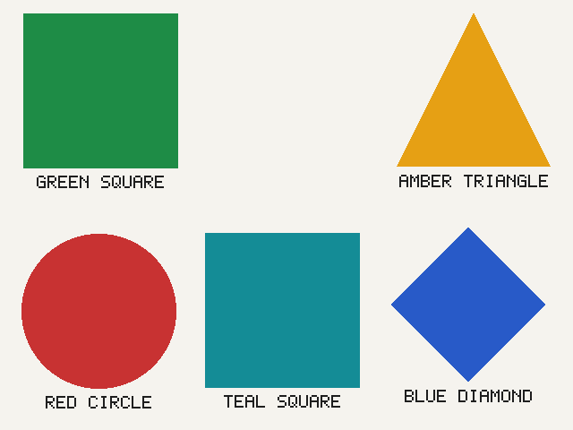 | The same, with its gold boxes 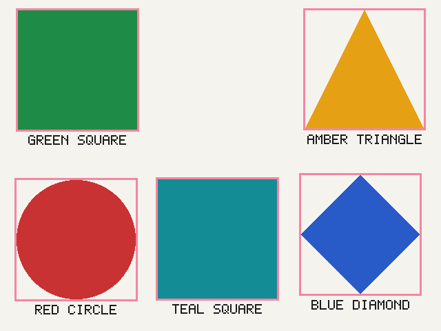 |
| A hard case: `perturbations=[("blur", 1), ("dim", 30)]` 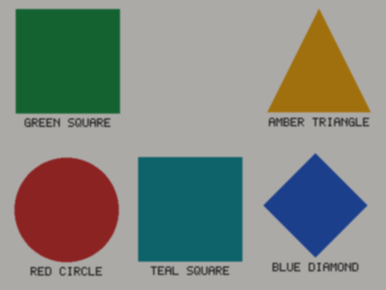 | `ui_mock(0)` 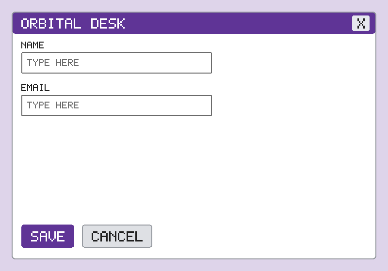 |
| `ui_mock(1, error=..., spinner=True)` 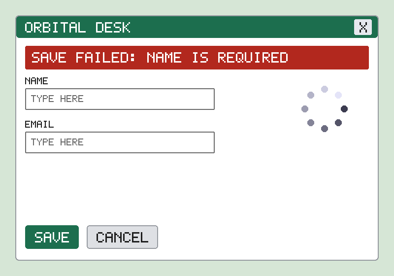 | Its gold boxes 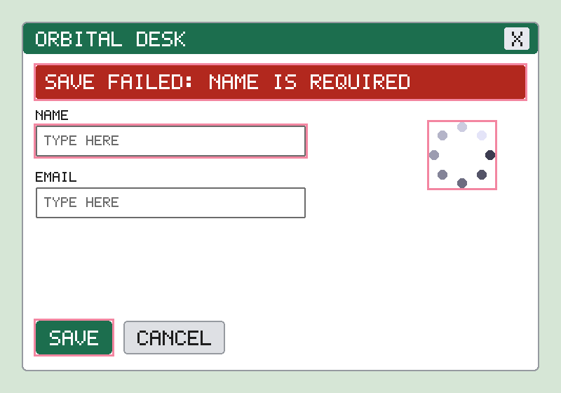 |
| `ui_mock(2, dialog=...)` 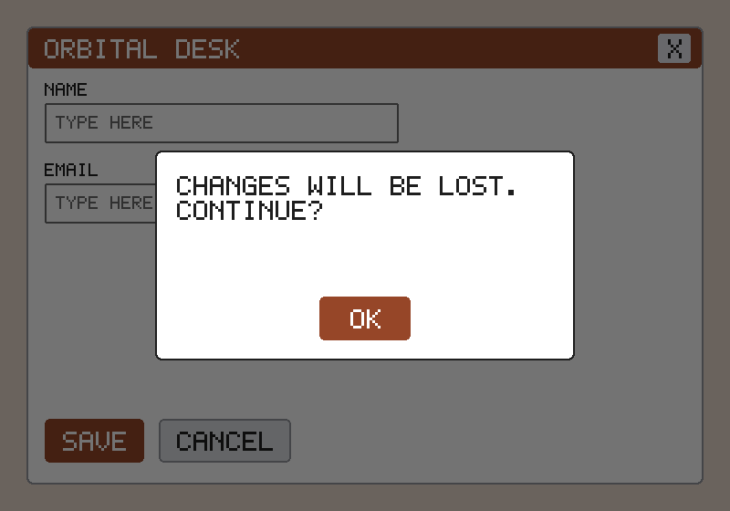 | `wordmark(8)` 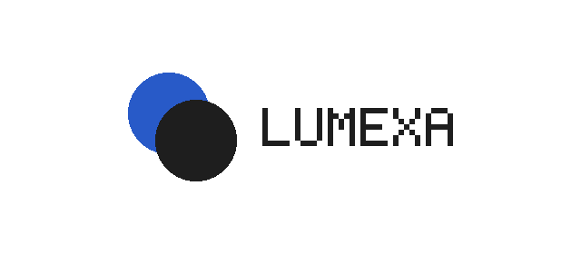 |
| `document_page(9)` 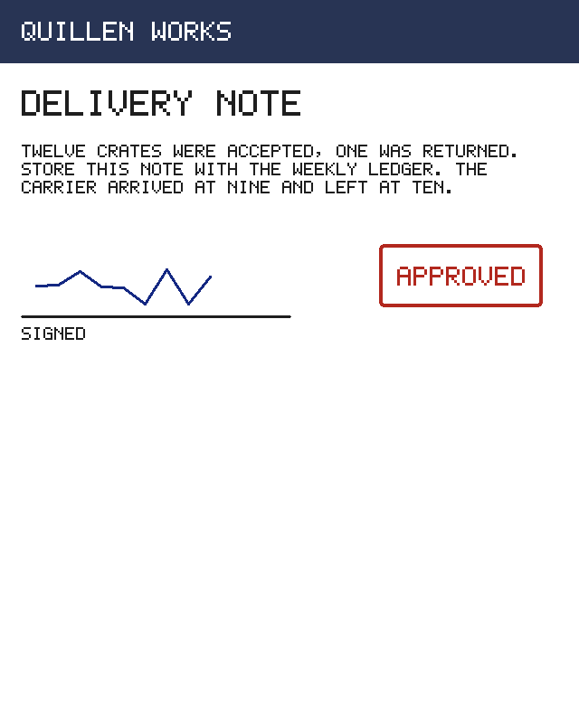 | `deck_builder_hud(10)` 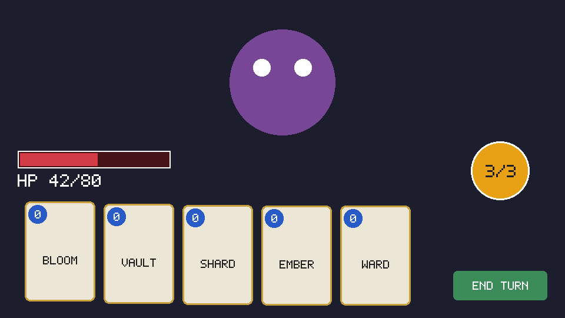 |
| `product_shelf(5, count=4, gaps=[2])` 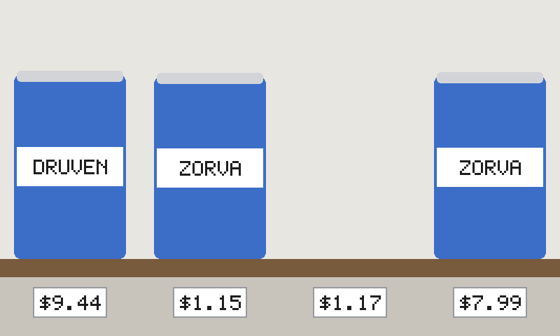 | Its gold boxes (the gap is a layout rectangle) 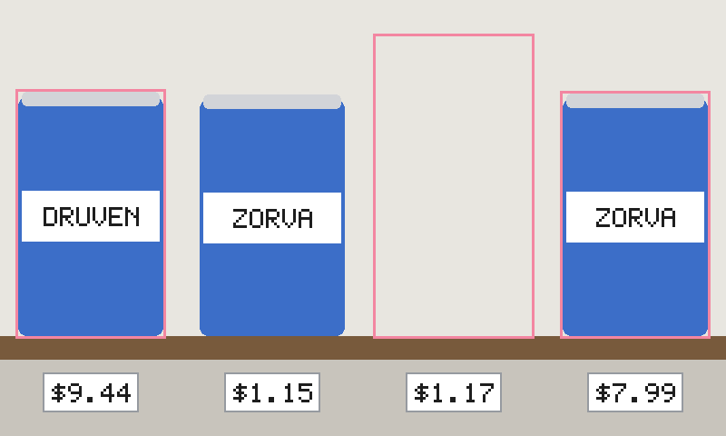 |
| `defect_panel(6, defect="scratch")` 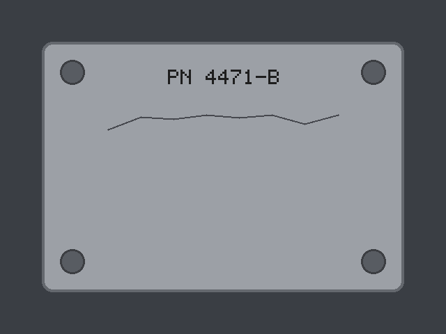 | The scratch's gold box 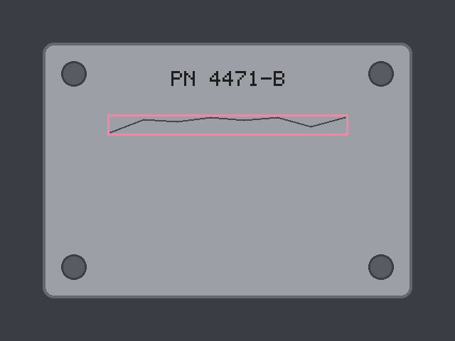 |
| `defect="dent"` 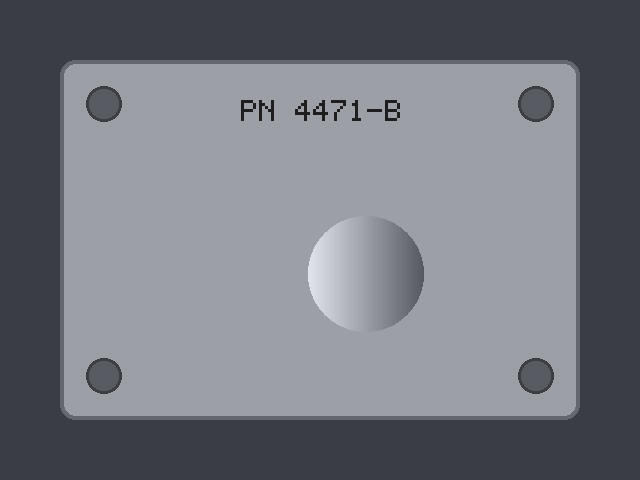 | `defect="missing_part"` 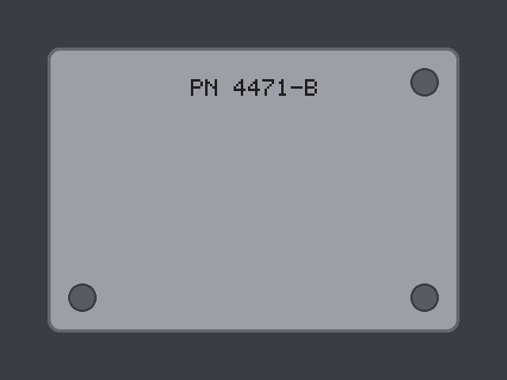 |
| `schematic(11)` 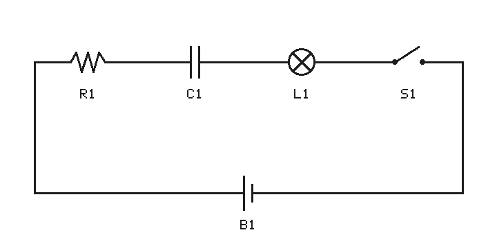 | |

Frame sequences (`moving_object_frames([0.0, 0.75, 1.5], seed=7)`, then
`appearing_object_frames([0.0, 1.0, 2.0], seed=7, appear_at=1.0)`):

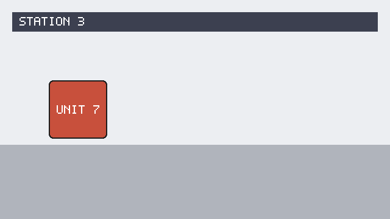
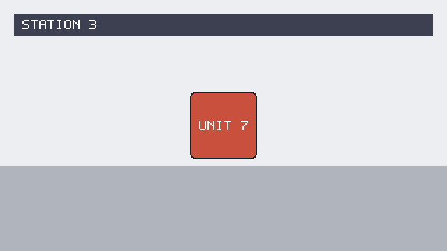
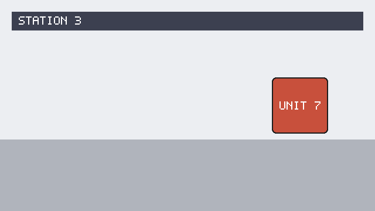
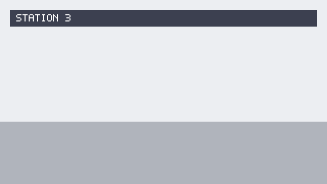


